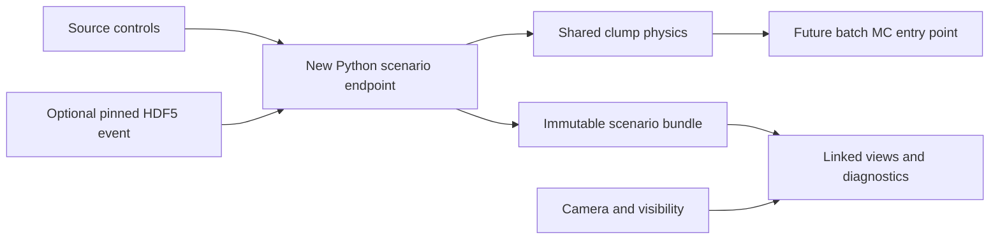

# HICAD A+B implementation handoff

**Implement the shared proton-clump generator core and interactive event display in this hicad checkout. This single file contains the required instructions, formulas, interfaces, example JSON and acceptance tests. No earlier chat, companion handoff documents, publication PDF or trained model is required.**

## Scope and working environment

All repository paths in this document are relative to the root of the checkout in which the agent is running. Determine that root from the current workspace; do not assume a particular username, absolute path, branch or checkout location. Read applicable repository instructions and inspect current files and uncommitted work before editing.

The design was informed by hicad revision `dd7ac5c7f025b5e194d1a95f75ad39e0a17ee8d8`. This is historical context, not a checkout requirement. Do not reset or switch the current checkout to that revision. Verify existing interfaces against the current code.

**Use new files and preserve existing work.** Record a baseline of relevant existing files at implementation start. Do not overwrite the original event-display HTML/server/README or thermal generator. If equivalent additions already exist, inspect and reuse them; add an adapter or extension rather than replacing them wholesale.

The required result is a working source-only explorer, support for a selectable pinned HDF5 background overlay, variable-parameter source generation, shared/decohered comparisons, diagnostics, reproducible recipe/snapshot JSON exports and tests. The shared core must be usable by a future batch MC entry point without HTTP.

A full production HDF5 campaign generator, exact conserving decay, ML detectors, OmniLearned transfer, weight-space experiments and SBI are outside this milestone. The HDF5 compatibility and background decoding section is included to decode existing backgrounds correctly, support the common precision preview and prepare future exports.

## Ownership for one or two coding agents

- **Agent A owns the physics core:** source sampling, boosts, acceptance, distribution/configuration validation, stream semantics and numerical/distribution tests.
- **Agent B owns the explorer:** scenario orchestration, HDF5 adapter, server API, frontend, diagnostics and downloads. B consumes A's core.
- If one agent does both, build the tested core first, then the source-only explorer and background integration.
- With two agents, agree on ScenarioSpec and the particle response before coding. Assign one owner to `clumps.py`; do not create separate samplers in the frontend, handler and future MC code.

Suggested core interfaces, with implementations free to use dataclasses internally:

```python
sample_rest_protons(n, temperature_gev, stream_factory, clump_id) -> p4_float64
sample_boost_vector(speed, direction_mode, rng) -> beta_float64
boost_four_vectors(p4, beta) -> p4_float64
apply_acceptance(p4, acceptance) -> boolean_mask
generate_clump(config, realization, clump_id) -> ClumpSample
generate_scenario(spec, background_provider) -> ScenarioBundle
```

The stream factory supplies independent per-daughter radial and angular generators. `ClumpSample` retains emitted rest/lab p4, accepted mask, stable daughter IDs and realized source parameters. Generation has no disk or HTTP side effects.

Deliver the complete working feature and verification results, not only a plan or UI mockup. Continue through the acceptance tests below. The required API routes and commands are to be implemented; explicitly optional extensions remain optional. They are not claims about current checkout capabilities.

# Scope and preservation rule

**Add new files. Preserve all existing repository files in this task**, including `toys/event-display/serve_h5_events.py`, `h5_event_display.html`, the existing README and the original thermal generator. The new default server port is 8766, so the old display can remain running on 8765. If a later implementation finds that a proposed new file already exists, inspect and integrate with it; do not overwrite work from another agent.

This file is the complete A+B implementation contract. Use the physics, schemas and examples included below. Preserve existing files and implement additions through new modules and entry points.

The first release needs an actual server-side canonical proton source, a working source-only mode with no HDF5 dependency at runtime beyond the installed package, optional HDF5 background loading, interactive controls, paired views, diagnostics and reproducible recipe downloads. A trained ML detector is not needed. Call the backend a **clump generator**; leave detector scoring outside this milestone. Do not show a CP probability or an invented anomaly score.

Use the physics defined in the Shared thermal source section: massive canonical Boltzmann emission, one common Lorentz boost, lab-frame acceptance and explicit angular controls. The source is spinodal-inspired. Its presence in a display does not establish a critical point or distinguish it from every noncritical cluster mechanism.

# Existing implementation and what to reuse

At the previously inspected repository snapshot, the server uses Python's `ThreadingHTTPServer`, NumPy and h5py. It indexes event summaries and reads active point-cloud rows lazily. The current frontend uses Three.js 0.171.0, WebGPU/TSL, OrbitControls and an optional bloom effect. Reuse the visual style and camera/geometry patterns in new files; retain the existing dependency versions initially. No framework migration is required.

| Existing behavior | Required behavior in the new explorer |
| --- | --- |
| `GET /api/event` clips eta and rounds physical arrays | Read HDF5 through a new precision-preserving adapter; do not use the old JSON endpoint as the physics source |
| Renderer silently limits particles to 4000 | Grow buffers, or explicitly report render-only sampling; never truncate the physical event |
| Cloud radius depends on pT divided by event mean pT | Default to true momentum coordinates and shared fixed axes; hiding background must not move source points |
| Requests are ignored while `loadingEvent` is true | Coalesce pending changes and always process the latest requested state |
| Catalog selection falls back on invalid file or empty centrality window | Return a clear selection error; never substitute another event silently |
| Species count p includes p and antiprotons | Show separate proton and antiproton counts |
| Stored Psi2 drives an event-plane graphic | Hide by default; thermal toy has no genuine anisotropic flow, and its stored-angle convention needs explicit handling |

The existing API actually uses query parameter `cur`, although its README says `cur_idx`. Avoid depending on that ambiguity: the new versioned API uses explicit JSON field names. Its apparent expansion animation is illustrative, not emission-position evolution. The existing cloud-only mode is also not a true Cartesian momentum plot. Correct these semantics in the new implementation without editing the legacy files.

# Shared thermal source

Use natural units, c = 1, momenta and masses in GeV, and internal float64 arithmetic. The proton mass is 0.938272088 GeV. Four-vector columns are always [E,px,py,pz]. Zero emitted multiplicity returns an empty (0,4) array and valid zero-count metadata. For each clump draw:

- Emitted proton count n from a configurable fixed, discrete-uniform or explicitly truncated shifted-Poisson distribution.
- Temperature T > 0 from a fixed or uniform distribution, sampled **once per clump**.
- Speed 0 <= beta < 1 from a fixed or uniform distribution, sampled once per clump.
- A single direction, shared by every daughter.

Start the UI with one clump; the source/configuration interface supports a bounded clump count. Keep event injection probability distinct from clump multiplicity. All ranges in the example configuration are sensitivity-study choices, not predictions of spinodal dynamics.

The canonical rest-frame emission law is:

```math
dP(\mathbf p^*)\propto
\exp[-(\sqrt{m_p^2+|\mathbf p^*|^2}-m_p)/T],d^3p^*.
```

Consequently, the radial density contains the phase-space factor p-squared. This is not the background's Gamma distribution in transverse momentum. Do not assume mean pT = 2T for this massive source. If the user later requests a particular mean pT, solve or tabulate it for the specified mass, boost and acceptance; it is not an independent temperature parameter.

**Use this rejection sampler**, which avoids a truncated momentum tail or a numerical inverse CDF. Let K = E* - m. Its target density is proportional to `(K+m) sqrt[K(K+2m)] exp(-K/T)`.

1. Choose k from {1,2,3} with weights proportional to `{m*m*T, 2*m*T*T, 2*T*T*T}`.
2. Draw K from Gamma(shape=k, scale=T).
3. Accept with probability `sqrt(K*(K+2*m))/(K+m)`; otherwise redraw.
4. Set E* = K + m and p* = sqrt[K(K+2m)].
5. Draw cos(theta*) uniformly on [-1,1] and phi* uniformly on [-pi,pi), and construct the Cartesian momentum. Do not draw theta* uniformly.

The proposal envelope is `(K+m)^2 exp(-K/T)`; multiplying it by the acceptance probability gives the desired density. Batch rejection sampling is straightforward with NumPy. Validate the sampled radial distribution against independent numerical integration. Invalid T must raise an error rather than be clipped.

Support two boost-direction modes:

- `transverse`: beta-vector = beta*(cos(phi_c), sin(phi_c), 0), with uniform phi_c. Recommended first benchmark for the existing full-azimuth acceptance.
- `isotropic_3d`: uniform azimuth and uniform cos(theta_c). This is a uniform direction on the sphere, not a uniform polar angle.

Initially, the direction is independent of the background event plane. Do not combine a separately sampled source rapidity with this vector until the order and meaning of the Lorentz transformations are explicitly defined.

For every daughter use the **same beta-vector**:

```math
E=\gamma(E^*+\boldsymbol\beta\cdot\mathbf p^*),\qquad
\mathbf p=\mathbf p^*+
\left[\gamma E^*+\frac{\gamma^2}{\gamma+1}
(\boldsymbol\beta\cdot\mathbf p^*)\right]\boldsymbol\beta,
\qquad \gamma=(1-|\boldsymbol\beta|^2)^{-1/2}.
```

This form avoids division by beta-squared at zero boost. Reject superluminal or nonfinite inputs. Do not replace the transformation by adding velocities, shifting pT, or drawing an independent kick for each daughter.

After boosting, derive pT, phi, eta = asinh(pz/pT), and rapidity y = asinh(pz/mT), where mT = sqrt(m²+pT²). Apply acceptance in the laboratory frame. Reject zero-pT tracks when eta is undefined; do not force them into acceptance by clipping. Distinguish pseudorapidity eta from rapidity y.

**Canonical emission versus exact decay:** independent thermal samples generally have nonzero total momentum in their nominal source frame. They describe emission from a thermal source coupled to a reservoir, not an exact decay of a fixed-mass parent. Implement `canonical_source` in this milestone. Exact center-of-momentum constraints, fixed-parent-mass decay, recoil compensation and globally conserving event generation are deferred; reject unsupported modes instead of approximating them silently.

The background and additive injection do not enforce complete collision energy-momentum and baryon conservation. This is an injection benchmark. The present thermal background has no genuine jets or anisotropic flow. A source with zero boost is not automatically indistinguishable from background: their thermal laws can differ, and shared fluctuating parameters can carry correlations.

# Configuration distributions and inline examples

The nested source schema is `hicad-clump-spec-1`; the explorer recipe schema is `hicad-clump-explorer-1`. Validate types and unknown/unsupported values before generation.

- Multiplicity: `fixed` with integer `value >= 0`; `uniform_integer` with inclusive integer `minimum` and `maximum`; `shifted_poisson_truncated` with `offset >= 0`, `mean >= 0` and `maximum >= offset`. The latter is n=offset+Poisson(mean), conditioned on n<=maximum by rejection, not clipping. Its mean field is the Poisson component mean. Enforce a sensible operational bound on pathological rejection costs and report any rejection-budget failure explicitly.
- T and beta: `fixed` with `value`, or `uniform` with `minimum < maximum`. T must be positive and beta subluminal; also honor the advertised service bounds. Draw each once per clump. The output records the realized values.
- Clump count: fixed nonnegative integer initially; optional bounded integer distribution through the same parser. A disabled source or zero clump count produces no daughters and leaves the background intact.
- The live explorer uses `signal_probability=1`. Validate its [0,1] range in the schema but reject non-unit values in the live API; random event-level injection is a later batch policy. Use the enabled control for deterministic source on/off.
- Only `injection_mode="add"`, `source_frame_mode="canonical_source"`, positive-proton species and full-azimuth acceptance are required. Do not imply unsupported replacement, exact-decay or detector modes.
- Acceptance is `abs(eta) < eta_max`, `pT >= pt_min_gev`, and, when supplied, `pT < pt_max_gev`. Eta max is positive, pT min nonnegative and pT max greater than pT min. Resolve inherited acceptance before generation; the live request requires numeric bounds.

The following is the complete default source-only POST body. Save it to a new example file only as part of the implementation; it is embedded here so this handoff stands alone.

```json
{
  "schema_version": "hicad-clump-explorer-1",
  "request_id": 1,
  "realization": {
    "root_seed": "42",
    "clump_revision": 0,
    "direction_revision": 0,
    "control_revision": 0
  },
  "background": {
    "provider": "none"
  },
  "clump_config": {
    "schema_version": "hicad-clump-spec-1",
    "enabled": true,
    "signal_probability": 1,
    "injection_mode": "add",
    "source_frame_mode": "canonical_source",
    "species": "p",
    "clumps_per_injected_event": {
      "distribution": "fixed",
      "value": 1
    },
    "emitted_multiplicity": {
      "distribution": "fixed",
      "value": 8
    },
    "temperature_gev": {
      "distribution": "fixed",
      "value": 0.1
    },
    "boost_speed": {
      "distribution": "fixed",
      "value": 0.4
    },
    "boost_direction": "transverse",
    "acceptance": {
      "eta_max": 1,
      "pt_min_gev": 0,
      "pt_max_gev": null,
      "azimuth": "full"
    },
    "variants": [
      "shared_boost",
      "azimuth_decohered"
    ],
    "shuffle_particles": true,
    "write_truth": true,
    "write_observed_p4_float32": true,
    "overwrite": false
  },
  "observation_mode": "native",
  "diagnostics": {
    "enabled": true,
    "pair_species": "positive_proton",
    "binning_id": "proton_clump_diagnostics_v1"
  }
}
```

For a variable-parameter scenario, replace the three fields inside that request's `clump_config` with this object fragment, keeping the other fields unchanged. It is a fragment, not a second complete request:

```json
{
  "emitted_multiplicity": {
    "distribution": "shifted_poisson_truncated",
    "offset": 2,
    "mean": 4.0,
    "maximum": 20,
    "truncation": "reject_and_redraw"
  },
  "temperature_gev": {
    "distribution": "uniform",
    "minimum": 0.06,
    "maximum": 0.16
  },
  "boost_speed": {
    "distribution": "uniform",
    "minimum": 0.0,
    "maximum": 0.6
  }
}
```

Support these distributions in the Python core/API. A basic n/T/beta slider panel may ship first; provide an advanced configuration editor or controls for the distribution-valued request before calling the full A+B task complete. All ranges above are exploration settings, not predictions.

The realized event must be reproducible from the saved recipe, RNG policy, source version and pinned background. When comparing observed twins, use the same particle IDs and aligned permutation; source membership must not be encoded by an appended block in any combined observation array.

# HDF5 compatibility and background decoding

This section is sufficient to implement background reads and the common packed preview without another document. Verify the schema in the current checkout before assuming the historical layout.

| Dataset | Shape and meaning |
| --- | --- |
| `mc_record` | float32 [2]: collision energy and MC family label; never a signal flag |
| `event_record` | float32 [N,10]: centrality fraction, M, b, Npart, Ncoll, sin(Psi2), cos(Psi2), mean pT, sum pT, mean eta |
| `point_cloud` | float16 [N,capacity,5]: cos(phi), sin(phi), log(pT/mean pT), Q*log(1+mass), eta-mean eta |
| `observed/p4`, when present | [N,capacity,4], [E,px,py,pz], aligned with active rows and padding |

Read exactly the first M particle rows. Decode pT as `event_record[7]*exp(point_cloud[:,2])`, eta as `point_cloud[:,4]+event_record[9]`, and phi as `atan2(point_cloud[:,1],point_cloud[:,0])`. Do not clip eta or round to display precision before calculations. Validate finite active values.

Decode species by nearest known signed mass code, using the current generator's species table. Historical species are pi+, pi-, K+, K-, p and pbar, with masses 0.13957039, 0.493677 and 0.938272088 GeV. The sign of the mass code is charge. Proton and antiproton counts are distinct. Do not use exact floating equality on quantized codes.

Set px=pT*cos(phi), py=pT*sin(phi), pz=pT*sinh(eta), mT=sqrt(m*m+pT*pT), E=sqrt(m*m+px*px+py*py+pz*pz), and y=asinh(pz/mT). Prefer a validated common observed/p4 dataset when available; keep species/charge alignment and provenance.

After composition, calculate M, mean/sum pT and mean eta from the final accepted particles. For the packed preview, encode **all** particles with those same means, cast to float16, then decode using the declared event-record precision. Never append pre-normalized source rows to an old event, or remove background from normalized combined rows without recomputing the source-only summaries. Empty observations have zero sums/counts and null undefined averages in JSON; the packed particle array is empty.

If a future HDF5 writer is added, keep the three original datasets compatible; active rows are [0:M] followed by exact zero padding. Allocate for final multiplicity without truncation. Store source and genealogy information separately under truth/event, truth/clumps and aligned truth/particle_clump_id (background -1, padding -2, clump IDs >=0). Record seeds, schema versions, configuration, units, code version, background lineage and variant. Apply one common observed precision path to every particle/class. This writer is not required to finish the current explorer milestone.

# New file layout

```text
toys/event-display/
  serve_clump_events.py
  clump_event_display.html
  README_clump_explorer.md
  clump_explorer/
    __init__.py
    api.py
    contracts.py
    scenario.py
    generator_adapter.py
    background.py
    diagnostics.py
    exports.py
    static/
      explorer.js
      controls.js
      renderer.js
      diagnostics.js
      explorer.css
    tests/
      test_scenario.py
      test_api.py
      test_background.py
      test_exports.py
toys/boltzmann/
  clumps.py                    shared physics helpers, if not already implemented
```

Keep transport-independent source sampling and Lorentz transformations in the shared `clumps.py` defined in this file. The explorer adapter loads that module through an explicit path resolved from `__file__`, or a package import once available. Do not depend on the current working directory, introduce a second sampler in JavaScript, or launch the old batch generator for each request. A future `generate_clumpy_h5.py` can call the same scenario layer while leaving the original thermal entry point intact.

If the shared physics code is not yet present, implementing the canonical-source subset in the Shared thermal source section is part of this feature. Do not substitute arbitrary Gaussian dots or return a permanently disabled Generate button.



# User controls and expected behavior

Use a desktop layout with a source-control panel, a large plot area and collapsible diagnostics. On narrow screens, stack controls and plots with normal scrolling; do not cover the canvas with an unscrollable control panel. Sliders need numeric input, units, visible values and keyboard operation. Debounce server work; the value label should update immediately.

| Control | Initial choice | Behavior |
| --- | --- | --- |
| Source enabled | On | Disabling produces zero source daughters; background remains available |
| Emitted protons n | 8 | Integer slider 0–40, numeric entry up to capability limit 200; this is emitted, not accepted count |
| Temperature | 100 MeV | Slider 20–250 MeV; convert to GeV in the request; display actual source mean pT as an output |
| Common boost beta | 0.4 | Slider 0–0.9, numeric entry up to initial service cap 0.95 |
| Direction distribution | Random transverse | Also isotropic 3D; current sampled direction remains fixed until explicitly redrawn |
| New clump | Button | Increment clump revision; preserve the pinned background |
| New direction | Button | Increment direction revision; preserve rest momenta, T, n and speed |
| Root seed | Decimal text, default 42 | Supports full uint64 without JavaScript integer rounding |
| Background source | None, or selected HDF5 dataset/event | Source-only mode works without files; selecting a new event does not redraw the clump |
| Centrality window and event navigation | All centralities | Select a background event, then pin its exact dataset/index for subsequent slider requests |
| Composition | Source only / Background only / Combined | Immediate local switch over the same cached components; no resampling |
| Compare variants | Shared / Decohered / Side by side | Same background and linked axes/camera; no regeneration when both are already returned |
| Lab acceptance | eta max 1, pT min 0, no pT max | Reapply cuts to the same generated particles; never redraw to reach accepted n |
| Projection | Cartesian momentum | Also transverse px–py and y–phi scatter; optional clearly labelled nonlinear ray view |
| Reveal source | Off initially | Truth highlighting explicitly labelled simulation truth; independent of composition |
| Show rejected daughters | Off | Ghost rejected source particles in a diagnostic view; observed counts still use accepted particles |
| Auto update | On | Off enables an Apply button; camera/color/visibility still respond instantly |
| Export | Recipe / Snapshot JSON / Image | Explicit download; slider changes do not write HDF5 files or campaign data |

Initial service bounds are operational limits, not physical predictions: at most 8 clumps, n at most 200 per clump, 0.001 <= T <= 0.5 GeV, 0 <= beta <= 0.95, and 20,000 supplied particles per scenario. Advertise limits in capabilities and reject excesses with an explanation. Do not silently clip requested physics values. The basic UI exposes one fixed-parameter clump; an advanced panel supports multiple clumps and the fixed/uniform/truncated-Poisson configuration defined in Configuration distributions and inline examples. Distribution controls may be delivered after the basic vertical slice, but the request schema must retain distribution-valued fields.

Mean pT is a measured output, not an independent input interchangeable with T. Changing T redraws rest momenta deterministically; changing beta boosts the same rest sample. Optional manual direction controls can come later and must become explicit recipe fields rather than undocumented UI state.

“Show background” can be offered as a shortcut between Source only and Combined. It changes displayed composition and its labelled summaries, never the source's p4 or the stored generated bundle. Keep separate readouts for generated source, accepted source and the currently displayed composition.

# Shared scenario and random stream contract

Implement a pure service interface:

```python
generate_scenario(spec: ScenarioSpec, background_provider: BackgroundProvider) -> ScenarioBundle
```

It receives validated physical parameters and explicit realization keys. It returns arrays and metadata; it performs no HTTP work and no persistent file writes. Start with background providers `none` and `hdf5`. Leave `thermal_live` and external MC providers as later implementations of the same interface. The HDF5 provider returns the precise selected row and source fingerprint, not a new random row on every call.

Use request-local NumPy RNGs and a versioned SeedSequence mapping with stable integer role identifiers. Do not use shared mutable server RNGs or Python's process-dependent hash. The key is:

```text
root_seed: decimal uint64 string
clump_revision: nonnegative integer
direction_revision: nonnegative integer
control_revision: nonnegative integer
```

Background selection uses its own seed and resolves to a pinned reference before scenario generation. Derive independent streams for parameter draws, radial momenta, rest-frame directions, collective direction, scrambling and aligned permutations. Use per-clump and per-daughter substreams so increasing fixed n preserves existing daughters, and adding a clump preserves existing clumps.

Required coupling:

- Identical request, source versions and background fingerprint reproduce identical physics arrays, independent of request order or client.
- Beta changes preserve the rest-frame sample and direction. Direction changes preserve the rest sample and speed.
- Acceptance changes preserve generated momenta and only change masks and summaries.
- Background selection and composition changes preserve all source momenta.
- New clump increments the clump revision and redraws its rest sample and, where distributions are enabled, its n/T/speed; collective direction stays fixed until New direction. New event may explicitly invoke both buttons and select a new background.
- Temperature changes reuse the declared stream seeds, but the rejection sampler need not produce a smooth particle trajectory as T changes. Do not animate its result as a physical trajectory.

Start with canonical independent emission and additive composition. Exact fixed-parent-mass decay, recoil compensation and replacement injection are separate physics modes and are not implied by the explorer. Keep their controls disabled/absent until supported.

# Background decoding and precision

Read original HDF5 datasets directly. Active particle rows are the first M from `event_record[:,1]`. Recover absolute pT and eta using the stored event means; decode species by nearest generator code and retain charge. Construct p4=[E,px,py,pz] with the declared particle mass. When a common `observed/p4` dataset is available, prefer it and validate its alignment. Keep all calculations in float64, without the legacy eta clip or decimal rounding.

Catalog entries need unique public dataset IDs even when two files share a basename. Use a server-side mapping to allowed files; scenario requests contain the returned ID, not arbitrary filesystem paths. Include file fingerprint, shape and event index in provenance. Open HDF5 handles within a controlled read operation; do not share an unguarded mutable handle across HTTP threads.

The background was already generated/selected within its original acceptance. Loosening an explorer cut cannot restore absent particles. Report known source acceptance or mark it unknown. Apply the explorer's current cuts consistently to the available background and generated source. Missing geometry/centrality in a source-only event is null, not fabricated zero-valued collision metadata.

The native preview mixes a quantized HDF5 background with newly generated source p4. Label this precision difference. Include a selectable common encode/decode preview before using screenshots or diagnostics to judge subtle low-q visibility: compose each accepted event, recompute means and encode all particles through the same chosen precision path. This preview may introduce tiny composition-dependent quantization changes; keep the canonical fixed-p4 view as the default comparison and label the alternate mode. Future ML export must apply identical observation/precision treatment to all classes.

Name these modes `native` and `packed_float16`. For the latter, return separate `observation_views[variant][composition]` arrays after encoding/decoding that specific accepted composition, preserving particle IDs. Use these arrays for both that view and its diagnostics; do not try to represent all quantized compositions with one shared source array. Canonical background/source arrays remain unchanged. Re-encoding cannot undo quantization already present in the HDF5 background.

# Variants and acceptance

Return `shared_boost` and `azimuth_decohered` in the first release. The background component is common to both. Generate the full shared lab sample once; store its rest p4 and common beta vector for diagnostics. Apply declared lab cuts, then form the decohered observed control by independently randomizing accepted daughters' azimuth while preserving pT, eta, species, IDs and ordering. With full-azimuth cuts, accepted counts and per-particle pT/eta match exactly.

To support rejected-particle ghost views consistently, the implementation may scramble all emitted source rows while retaining the shared acceptance mask; its accepted subset must equal the construction above. Do not describe ghost tracks as measured. Nonuniform phi acceptance requires a new matched-control definition and is outside v1.

Derive each scrambled azimuth from that daughter's stable ID and control stream, not its position in the current accepted subset. Then changing acceptance does not redraw the control angles of daughters that remain accepted.

The optional `independent_boost` variant uses independent boost directions per daughter. It can have different accepted counts and is not an exact angular twin. Its realized daughter boost vectors belong in truth. The request validator should reject an unsupported variant rather than substitute the shared one.

Keep lab acceptance separate from rest-frame inspection. A rest-frame plot applies no new rest-frame acceptance; highlight which daughters passed the lab cuts and omit a misleading common rest-frame background. A common boost preserves source-pair q_inv. Acceptance can change the selected pairs, so acceptance-limited q_inv histograms need not be identical as beta changes.

For pathological zero-pT particles, represent undefined eta/phi as null in optional display fields, reject them from cuts that require those coordinates, and count the reason. Never emit NaN/Infinity JSON or replace a singular coordinate with a plausible arbitrary value. The p4 itself remains the authoritative physical record.

# Versioned server API

Use a new `/api/v1/` namespace and explicit static-file routes. Keep the standard-library server for the small NumPy workload. Serve on loopback by default, use same-origin requests, and accept declared JSON only. There is no need for a subprocess, shell command or disk-generated HDF5 event per slider update.

| Endpoint | Contract |
| --- | --- |
| `GET /api/v1/capabilities` | Schema/generator/RNG versions, providers, variants, limits, precision modes, feature availability |
| `GET /api/v1/backgrounds` | Public dataset IDs, labels, event counts, available metadata and fingerprints |
| `POST /api/v1/background/select` | Resolve dataset, exact/random/next/previous selection and centrality window into a pinned reference |
| `POST /api/v1/scenario` | Validate the full recipe, generate or reuse a deterministic bundle, echo request_id |
| `POST /api/v1/diagnostics` | Optional deferred calculation for scenario_id, observation mode, variant, composition and binning ID |
| `GET /api/v1/scenarios/{id}/recipe` | Download the normalized physical recipe and provenance for a cached scenario |
| `GET /api/v1/scenarios/{id}/snapshot` | Download full-resolution JSON with measured fields, separate truth and selected variant metadata |

Selection requests have `dataset_id`, `mode`, optional `event_index` or `current_index`, `centrality_min`, `centrality_max` and decimal-string `selection_seed`. Use centrality [min,max), with the final upper edge 1 inclusive. Validate exact indices and filters; an empty match is an explicit error. Return the resolved dataset ID, event index, fingerprint and selection metadata. Subsequent scenario calls use this exact reference and do not rerun selection.

The Configuration distributions and inline examples section contains the full source-only POST body; no companion JSON file is needed. `clump_config` follows `hicad-clump-spec-1`; use explicit numeric acceptance rather than `inherit_energy_config` in a resolved request. `signal_probability=1` in the live explorer: each requested preview shows the configured source. Its `write_*` and overwrite fields are recipe metadata for future persistence and must not trigger file writes during preview. Camera, visibility, colors and composition do not belong in the physical request.

For HDF5 background, replace `{"provider":"none"}` with `{"provider":"hdf5","dataset_id":...,"event_index":...,"fingerprint":...}` using selection results. Pin the fingerprint and report changed/missing data instead of reading a different file.

The response contract is:

```text
schema_version, request_id, scenario_id, resolved_request
provenance: generator/core version, RNG policy, background reference, units, precision
source_truth: realized per-clump n, T, beta vectors, emitted/accepted counts
background:
  measured: particle_id[], species[], charge[], p4[N,4], accepted[N]
  metadata: original event summary and source acceptance
variants[name]:
  measured: particle_id[], species[], charge[], p4[Nsource,4], accepted[Nsource]
  truth: clump_id[], rest_p4[], and boost information where applicable
summaries[variant][source_only|background_only|combined]
diagnostics[variant][source_only|background_only|combined]
timing_ms, warnings[]
```

Arrays are unpadded and internally aligned. IDs distinguish background rows from clump/daughter identities and are stable across linked views. Source-origin information is simulation truth even when the UI needs it for component selection; the future model-facing adapter strips it. Do not concatenate it into ML features. Send the background once, not duplicated for each variant. Zero accepted particles is a successful response with zero counts, empty plots and null undefined averages.

Build scenario_id from a canonical representation of physical configuration, realization keys, source version and background fingerprint. Exclude request_id, timings and frontend view state. A bounded cache, for example 32 bundles or 128 MiB whichever comes first, may reuse results. Cached replies must echo the current request_id. Cache eviction returns an explicit expired response; the saved recipe can regenerate the bundle. A download captures the displayed scenario ID, never an unresolved pending UI draft.

Cache canonical physical arrays separately from diagnostics and quantized observation views, whose keys include their requested modes, composition and binning. Every deferred diagnostic response echoes scenario_id and its diagnostic configuration. The browser applies it only when these match the committed scene and selected diagnostic view. A late histogram must not replace the diagnostics of a newer event.

Use structured errors such as `{"error":{"code":"invalid_parameter","field":"clump_config.boost_speed.value","message":"..."},"request_id":17}`. Return 400 for malformed JSON, 422 for invalid parameters/limits, 404 for unknown dataset/event, 409 for a changed source fingerprint, 410 for evicted scenario and 503 for a busy bounded generation service. Validate request-body size and finite numeric fields. Do not silently fall back to another source or clip physics inputs.

# Responsiveness and browser state

Keep separate `draftSpec`, `committedScenario` and `viewState`. The slider label reflects the draft; event plots and statistics reflect the last complete committed scenario. While they differ, show a small Updating indicator. If a request fails, preserve the previous scene and show the error beside the affected control.

Use a 200 ms debounce for physical controls and an immediate trailing submission on pointer release or explicit Apply. Maintain at most one normal in-flight request and one pending latest draft. Replace the pending draft as the user drags; after completion, submit only the newest pending state. Never drop the final slider value. Increment a request sequence when the physical draft changes, and commit a response only if its sequence matches the current requested state. This also protects against delayed network responses or independent view actions. An AbortController may stop client waiting on reset/unload, but it does not guarantee server computation was cancelled.

Bound concurrent generation work on the server, keep catalog/static routes responsive and handle 503 by retrying only the latest draft after a short delay. No WebSocket or job queue is needed for the initial toy. If future MC exceeds interactive latency, introduce an explicit asynchronous provider; the UI should then show jobs rather than pretending to deliver live slider updates.

Update buffers in place where practical; dispose obsolete GPU allocations when growing them. Keep camera position and user-selected axes on scenario updates. Local view operations and animation frames must not issue generation requests. Do not replay expansion automatically after every slider movement; use a separate Replay button.

Development targets, to measure rather than assume: visible local-control response within one animation frame, source-only generation/serialization under 100 ms, and an ordinary BES background scenario under 300 ms on the development machine. Record p50/p95 times for source-only, BES and a central LHC background. If pair diagnostics dominate, move them to a separate deferred calculation rather than delaying the event scene.

# Visualization and diagnostics

Default 3D coordinates are `(px,py,pz)` in GeV, with optional common user-chosen pz scale explicitly labelled. Use common axis ranges across source-only/combined and shared/decohered views. Auto-fit must be an explicit action over the union of compared particles; hiding background must not trigger it. Add px–py and y–phi views because localized correlations may be clearer there. Handle the phi wrap boundary; a cluster crossing minus pi/pi must not be presented as two unrelated objects.

Truth colors, source direction arrow and rest-frame view are teaching/diagnostic aids. Provide a neutral species or momentum coloring to assess observational visibility. Distinguish protons from antiprotons. Do not render a reconstructed spatial droplet, emission radius or physical lifetime: the requested toy specifies momenta, not emission positions.

Show emitted and accepted n per source, observed total/proton/antiproton counts, mean pT and the sampled T/beta. Use full accepted data for statistics, even if an explicitly labelled display-only subset is drawn. Default rendering should include every particle within the advertised interactive limit. If a browser cannot handle that, offer a stable subset and display `rendered N of M`; never preferentially keep high-pT particles or silently remove source daughters.

For accepted positive protons, compute fixed-bin pT, y, delta-phi, abs(delta-y), q_inv and pair-betaT histograms, with the same binning across views. Distinguish all observed proton pairs from truth-selected daughter pairs. The latter explains the mechanism; it is not an experimental observable. Show number of pairs and normalization. For fewer than two protons, display No proton pairs, not an artificial zero-q peak.

Define `proton_clump_diagnostics_v1` with uniform bins: pT 0–3 GeV in 60 bins; y -2.5–2.5 in 50; wrapped delta-phi -pi–pi in 72; abs(delta-y) 0–5 in 50; q_inv 0–2 GeV in 80; pair-betaT 0–1 in 50. Return raw counts, edges, underflow, overflow and total entries. A normalized density uses total entries, including overflow, in its denominator. Compute unordered distinct pairs exactly once. For signed delta-phi, fill both signs with weight one half so the histogram is independent of particle ordering; return the corresponding weights. Use q_inv=sqrt(-(p_i-p_j)^2) for equal-mass protons, with only roundoff-level negative squares clamped, and pair-betaT=|pTi_vector+pTj_vector|/(Ei+Ej).

Calculate complete pair statistics in bounded chunks without allocating all pair vectors. For expensive multiplicities, deliver them asynchronously after the scene or make the cost explicit; any approximate histogram must label its sampled pair count and preserve an exact mode. Fixed bin edges, units and normalization are returned in diagnostics, so the browser does not invent inconsistent histogram definitions.

The generator has no genuine flow or jets. A visible clump does not establish their rejection. The beta=0, fixed-T canonical source and its angular twin should be statistically indistinguishable across many events, although individual pictures can differ and the source spectrum may differ from the thermal background.

# Export and future MC integration

Recipe JSON contains resolved parameters, distributions, realization keys, RNG/core versions, acceptance, requested variants and the pinned background fingerprint. The example schema is `hicad-clump-explorer-1`; preserve the nested generator schema separately. Snapshot JSON contains full p4 and separate truth. Optionally append frontend view state under a clearly separate `view_state` key for reproducing a screenshot; it must not affect scenario generation or its physical identifier.

Add a source-only recipe export immediately. HDF5 event/campaign export is a later adapter using the same arrays and the HDF5 compatibility and background decoding contract. Source-only and combined exports each need newly computed event means and relative features. Never remove background rows from an already normalized combined point cloud and claim it is a correctly encoded source-only event.

Do not invent collision metadata for source-only HDF5 exports. Define that metadata policy before enabling such export. Additive embedding does not enforce global collision energy/baryon conservation; label it as an injection benchmark. Future production MC must choose conservation and detector-response models explicitly.

The eventual batch generator should call the same core/ScenarioSpec mapping without an HTTP server. Given the same realized source parameters, streams and background, interactive and batch generation must agree numerically. This parity test is the main reason to keep generation outside the frontend and HTTP handler. A later optional scorer receives only the accepted observed event and returns its model/checkpoint/calibration identifiers; it never receives truth colors or clump IDs.

# Tests and delivery gates

1. **Preservation:** compare pre-existing files against a baseline captured at the start of this implementation, preserving any work already in the checkout; the feature adds files only. The existing display still starts on 8765 and the new one on 8766.
2. **Physics:** reuse mass-shell, rest isotropy, thermal radial-law, zero/inverse boost and common-boost q_inv tests. Reject invalid T/beta/n and never redraw merely to reach accepted multiplicity.
3. **Coupling:** background visibility changes no source p4; beta changes no rest p4; direction changes no rest p4; acceptance changes no generated p4; n increases preserve the first n daughters. Requests in different orders and from different clients give the same seeded results.
4. **Controls:** shared/decohered twins have identical accepted IDs, species, pT and eta. Compare common-boost q_inv on identical full-source pair identities, not differently accepted subsets.
5. **Data:** background decode has no hidden eta clipping or display rounding; file IDs cannot collide; no matching centrality produces an error; missing HDF5 files still permit source-only mode. Test zero/one accepted daughter and no accepted particles.
6. **API:** schema/field errors are explicit; cached responses echo current request IDs; source changes invalidate fingerprints; no preview request writes a persistent dataset; snapshots round-trip seeds, p4, truth separation and provenance.
7. **UI races:** delay responses deliberately, drag n/T/beta rapidly, and verify that the final scene matches the last control values. Test reset during a request, auto-update off, service errors and retry. No stale response may overwrite a newer scenario.
8. **Visual correctness:** confirm a source has identical coordinates before/after background toggle, linked views have common scales, phi wrapping is handled, truth overlays are labelled, and generated/accepted/rendered counts are distinct. Inspect desktop and narrow layouts and keyboard controls.
9. **Performance:** measure latency and particle limits, then repeat updates to check GPU/buffer cleanup. If WebGPU is unavailable, provide the 2D Canvas views and a clear 3D-unavailable message; physics controls and downloads should still work.

Initialize controls, network state and the 2D renderer independently of Three.js. Load the optional 3D module with a caught dynamic import so a missing GPU or failed CDN import does not prevent the fallback UI from starting. Preserve system-font fallbacks when web fonts are unavailable.

Suggested development order: new source-only server and page; fixed n/T/beta controls; pinned background provider; linked decohered comparisons and diagnostics; exports and advanced parameter distributions. Keep future MC/scorer adapters separate from this first working explorer.

Proposed commands after implementation, from the current checkout root, using its active Python environment. If that environment is launched through `henv -x`, prefix these commands accordingly; `henv` is not required:

```bash
python toys/event-display/serve_clump_events.py --port 8766 --open-browser
python toys/event-display/serve_clump_events.py --data-dir toys/boltzmann/output --port 8766 --open-browser
python -m unittest discover -s toys/event-display/clump_explorer/tests
```

The README added by the coding agent should document controls, exact seed semantics, supported providers, precision modes, sample recipes and the known absence of real flow/jets. The implementation is complete when moving a physical control produces a validated server-generated event, background toggling preserves the source, exports reproduce the scenario, and the old display remains untouched.
